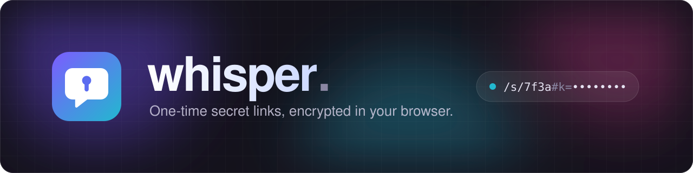

<p align="center">
  
</p>

# whisper

Share a secret through a link that works once and expires after a chosen TTL.

## Why whisper

- **Encrypted before it leaves your browser.** The server only ever stores
  scrambled data it cannot read.
- **The key stays in the link.** Only the person holding the link can unlock
  the secret. Not the server, not the database.
- **Opens exactly once.** After the first view, the secret is deleted for
  good.
- **Expires on its own.** Pick 5 minutes, an hour, a day or a week. Unread
  secrets vanish too.
- **Safe from link previews.** Chat apps that unfurl links can't burn the
  secret. It only opens on a click.
- **No account, nothing to install.** Paste, pick an expiry, share the link.
- **Yours to host.** Deploys to Vercel with Upstash Redis in a few clicks.

## How it works

The secret is encrypted in the browser (AES-256-GCM). The key lives only in
the URL fragment (`#k=…`), which browsers never send to the server, so the
server and Redis only ever hold ciphertext.

1. The browser encrypts the secret and `POST /api/secrets` stores the
   ciphertext in Redis with `EX <ttl>`.
2. The link is `/s/<id>#k=<key>&e=<expiresAt>`.
3. Opening the link shows a **Reveal** button. Clicking it calls
   `POST /api/secrets/<id>/reveal`, which runs an atomic `GETDEL`, so only
   one reader ever gets the payload. Link-preview bots that only `GET` the
   page cannot burn the secret.
4. Once Redis has dropped the key, the page uses `e` from the fragment to
   tell "expired" apart from "already viewed".

## Quickstart

```bash
corepack enable
yarn install
docker compose up -d           # Redis + Upstash-compatible HTTP shim
cp .env.example .env.local
yarn dev                       # http://localhost:3000
```

`yarn verify` runs typecheck, lint, unit tests and a production build.

## Deploy to Vercel

1. Push the repo and import it in Vercel.
2. In the project, open **Storage → Marketplace → Upstash for Redis** and
   connect a database. This sets `KV_REST_API_URL` / `KV_REST_API_TOKEN`,
   which the app picks up as is. Setting `UPSTASH_REDIS_REST_URL` /
   `UPSTASH_REDIS_REST_TOKEN` yourself also works.
3. Deploy.

## Layout

| Path                          | Contents                                        |
| ----------------------------- | ----------------------------------------------- |
| `src/app/`                    | Routes: `/`, `/s/[id]`, and the API handlers    |
| `src/features/styleguide/`    | Dev-only `/styleguide` page, see `DESIGN.md`    |
| `src/features/create-secret/` | Create form and share-link view                 |
| `src/features/reveal-secret/` | Reveal flow and its expired/gone/invalid states |
| `src/lib/crypto.ts`           | Web Crypto encrypt/decrypt                      |
| `src/lib/share-link.ts`       | Builds and parses the URL fragment              |
| `src/lib/secret-store.ts`     | Redis access (server only)                      |
| `src/schemas/secret.ts`       | TTL options, limits, request validation         |
| `src/components/ui/`          | shadcn primitives (generated)                   |
